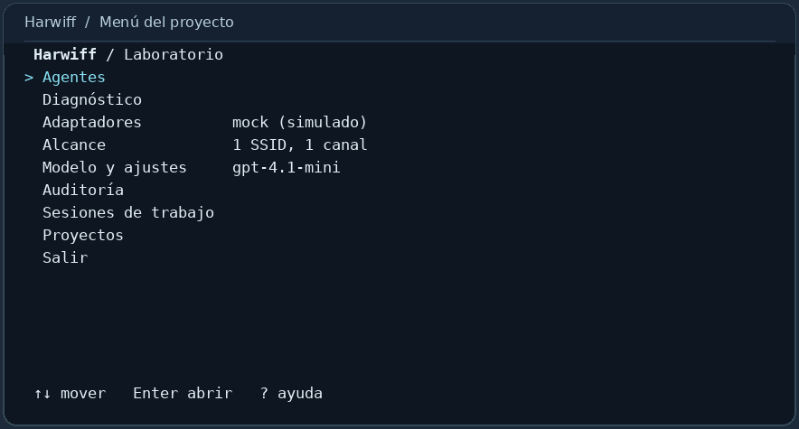
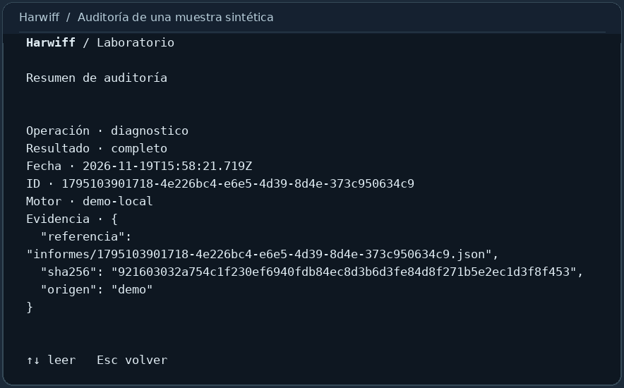
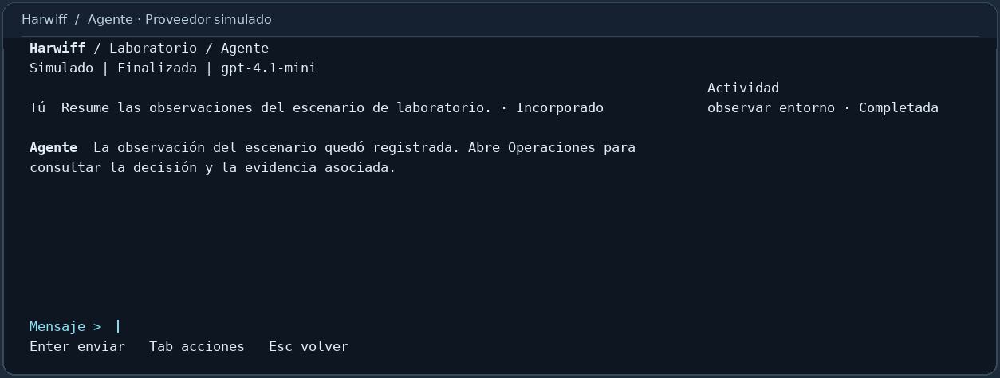

# Harwiff

**Diagnóstico Wi‑Fi de solo lectura desde la terminal.** Abre un proyecto, inspecciona sus adaptadores y conserva cada informe con su registro de auditoría. Puedes empezar con una muestra sintética y conectar un proveedor cuando quieras usar el agente.

[Instalar](#instalación) · [Primera prueba](#primera-prueba-sin-docker) · [Agente](#conversar-con-el-agente) · [Diagnóstico físico](#diagnóstico-físico) · [Descargas](https://github.com/glender222/wifi-diagnostico-harness/releases/latest)



## Inspección Wi-Fi con el agente

Desde un proyecto abierto en Harwiff, usa **Adaptadores → tu radio → Inspeccionar en solo lectura** o **Diagnóstico → Inspección Wi-Fi de solo lectura**. **Solo datos del host** inicia el resumen de la interfaz de inmediato, incluso si la tarjeta sostiene la ruta principal. Después del resultado puedes hacer otra pregunta. En la consola:

```text
/agente --inspeccion -- ¿Qué radios Wi-Fi detectas?
/agente --inspeccion --interfaz wlp1s0 -- ¿Qué rutas IPv4 e IPv6 observas?
/agente --inspeccion --interfaz wlp1s0 --red-del-proyecto -- Describe la asociación autorizada.
/agente --inspeccion --historial -- Recupera la evidencia con ID <id-de-auditoría>.
```

Sustituye `wlp1s0` por la interfaz elegida. La selección de inspección admite la tarjeta que sostiene la ruta principal y las consultas de host funcionan sin configurar un SSID. `--red-del-proyecto` habilita datos de asociación cuando el enlace coincide con el alcance guardado. La evidencia se consulta en `/auditoria <id>`. Para recuperar una evidencia histórica de enlace, repite la selección de interfaz y permisos originales.

La inspección usa el proveedor configurado en el proyecto. Para usar otro adaptador de Pi compatible, establece `HARWIFF_LLM_PROVIDER` y `HARWIFF_LLM_MODEL` al iniciar Harwiff y configura las credenciales de ese proveedor mediante su mecanismo habitual. También puedes guardar `provider`, `model` y, cuando haga falta, `contextWindow` bajo `llm.inspeccion` en el manifiesto. El recorrido exige una comprobación sintética de tool calling antes de consultar el hardware. Los hechos se muestran con citas verificables y las interpretaciones se presentan como hipótesis con sus límites.

Desde código fuente, instala `jsonschema==4.26.0` en el Python usado por Harwiff. Puedes seleccionar ese intérprete mediante `WIFI_PYTHON`. El paquete Linux lo incluye. Las pruebas de protocolos simulados se ejecutan con `node tests/inspeccion.mjs`. Para registrar corridas con un modelo real, usa `node tests/inspeccion-real.mjs <proyecto-autorizado> <interfaz>`. El runner separa el oráculo automático de la revisión humana. Agrega `--usb` para el perfil del segundo equipo.

## Instalación

El paquete es para **Linux x86‑64 con glibc**. Incluye Node.js, Python, el lector Wi‑Fi nativo, Pi y OpenSandbox. El instalador verifica el SHA‑256 del paquete, instala sin `sudo` y activa el comando en `~/.local/bin/harwiff`.

```bash
curl -fsSLo /tmp/harwiff-install.sh \
  https://github.com/glender222/wifi-diagnostico-harness/releases/latest/download/install.sh
bash /tmp/harwiff-install.sh
~/.local/bin/harwiff --version
```

Si `harwiff` no aparece en tu `PATH`, puedes ejecutarlo con `~/.local/bin/harwiff`. Ejecutar el instalador de nuevo actualiza el comando y conserva los proyectos en sus respectivas carpetas. Cada paquete indica su versión, canal y commit con `harwiff --version`.

| Modo | Requisitos adicionales | Resultado |
| --- | --- | --- |
| Muestra sintética | Ninguno | Informe de ejemplo y registro de auditoría |
| Inventario local | Linux con adaptador Wi‑Fi para ver un radio físico | Dispositivos, interfaces, capacidades anunciadas y avisos |
| Diagnóstico físico | Docker operativo, NetworkManager, iproute2 y adaptador seleccionado | Indicadores de solo lectura procesados con OpenSandbox |
| Conversación con agente | OpenAI API o Azure AI Foundry, modelo compatible y alcance para `mock` | Respuesta, decisiones de herramientas y evidencia del escenario simulado |

## Primera prueba sin Docker

```bash
mkdir -p ~/laboratorio-wifi
cd ~/laboratorio-wifi
harwiff
```

1. Elige **Inicializar esta carpeta** y pulsa **Enter**.
2. Abre **Diagnóstico → Generar muestra sintética**.
3. Desde **Ver en Auditoría**, abre el resumen o el JSON. El informe queda guardado en `.harwiff/informes/`.

Usa **↑** y **↓** para moverte, **Enter** para abrir y **Esc** para volver. **?** abre Ayuda en el menú principal. La TUI admite ventanas desde 60×16. En el chat, a partir de 120 columnas, la actividad aparece a la derecha.



## Conversar con el agente

1. En **Alcance → Editar alcance**, añade el SSID `LAB_TEST_AP` y el canal `6`.
2. En **Adaptadores**, abre **Mock · Simulado** y elige **Usar este adaptador**.
3. En **Modelo y ajustes**, conecta un proveedor y elige el modelo para sesiones nuevas.
4. Abre **Agentes → Nueva conversación** y escribe, por ejemplo, «Resume las observaciones del escenario de laboratorio».



**Tab** abre **Operaciones**, **Detalle de turnos** y **Detener turno**. **Esc** vuelve a la lista y el turno puede seguir trabajando. Harwiff conserva el borrador y la posición de lectura al volver a la sesión. «Incorporado» indica que el mensaje fue admitido localmente. Las operaciones muestran su decisión, motivo y referencias de evidencia.

### Proveedores

- **OpenAI API**. Introduce la clave en el campo oculto de **Conexiones de proveedor** o usa `OPENAI_API_KEY`. Harwiff puede conservar la clave en Secret Service. Si el almacén falla, la clave recién conectada permanece en memoria hasta cerrar la aplicación. El modelo debe admitir Responses y llamadas a herramientas.
- **Azure AI Foundry**. Exporta `FOUNDRY_API_KEY` en la terminal desde la que arrancas Harwiff. Después configura el dominio y el deployment en **Conexiones de proveedor → Azure AI Foundry**. El deployment debe admitir Chat Completions v1 y herramientas.

**Probar conexión** hace una solicitud al proveedor que puede consumir tokens. El modelo del proyecto se aplica a sesiones nuevas. Las sesiones existentes conservan su modelo. Los agentes operan sobre el escenario simulado. Pueden consultar un resumen depurado del inventario del host dentro de sus límites de turno. Las capturas del chat usan un proveedor simulado.

## Diagnóstico físico

Abre **Adaptadores** para consultar radios, interfaces, restricciones y capacidades anunciadas por el kernel. El lector usa sysfs y `nl80211`. Puede mostrar un inventario parcial cuando falte una fuente. Las capacidades anunciadas de monitor y concurrencia aparecen como **sin pruebas operativas**.

1. Guarda los SSID o BSSID autorizados y, si corresponde, los canales en **Alcance**. Cada lista configurada debe coincidir con la asociación observada.
2. En **Adaptadores**, abre el radio, revisa las restricciones y elige **Usar para diagnóstico físico**. Harwiff guarda la selección cuando supera el preflight.
3. Con Docker, NetworkManager e iproute2 operativos, abre **Diagnóstico → Ejecutar en modo físico**. El informe y su verificación quedan en **Auditoría**.

Harwiff bloquea la operación si el radio sostiene una ruta por defecto IPv4 o IPv6, o si no puede verificar esa dependencia. El colector consulta la asociación local y envía indicadores depurados a OpenSandbox. La lectura cubre el estado local informado por NetworkManager. El diagnóstico no mide acceso a Internet ni resolución DNS. En el primer uso físico se descargan las imágenes de contenedor fijadas por el proyecto. [OpenSandbox](https://open-sandbox.ai/getting-started/installation)

## Proyectos, notas y automatización

Los proyectos nuevos guardan sus datos en `.harwiff/`. Se reconocen también proyectos anteriores con `harness.json` en la raíz. Abre **Proyectos → Abrir proyecto** para buscar en una carpeta. En **Sesiones de trabajo** puedes organizar notas y contexto técnico.

| Ruta relativa al proyecto de Harwiff | Contenido |
| --- | --- |
| `harness.json` y `control-wifi.json` | Configuración, adaptador y alcance |
| `informes/` y `auditoria/` | Informes JSON, resultados y referencias de evidencia |
| `agentes/` y `sesiones/` | Conversaciones y notas de trabajo |

**Ayuda → Consola de comandos** abre la vista de comandos. El listado por ruta y la entrada por tubería sirven para scripts.

```bash
harwiff proyectos --json --profundidad 2 "$HOME/Proyectos"
printf '%s\n' '/diagnostico demo' '/auditoria' '/salir' | harwiff ~/laboratorio-wifi
```

El lote mantiene los resultados en stdout, escribe los errores en stderr y devuelve código 1 si alguna línea falla. El ejemplo supone un proyecto ya inicializado.

## Desarrollo

Usa Node.js 22.23.5, Python 3.12 y `uv`. Para ejecutar la TUI desde el código fuente:

```bash
npm ci --ignore-scripts
npm start
```

`scripts/build-release.sh` prepara el instalador, el paquete y su checksum. CI ejecuta las pruebas de agente, CLI, terminal e instalación limpia en Ubuntu 22.04 y Debian 12. Las pruebas de proveedor emplean fixtures. [Acciones de GitHub](https://github.com/glender222/wifi-diagnostico-harness/actions) · [Atribuciones y licencias](THIRD_PARTY.md)
